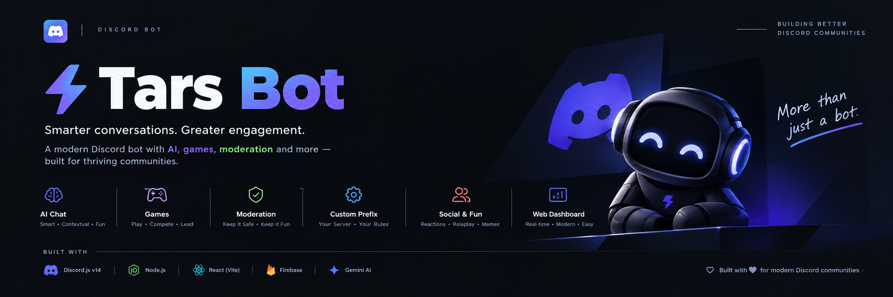

# Tars Bot 🤖



A sharp-witted, modern Discord bot built with **Discord.js v14**, **Node.js**, **React (Vite Dashboard)**, and powered by **Google Gemini AI**. Designed for server engagement, interactive games, custom prefix management, and dynamic help interfaces.

---

## ✨ Features

- **🧠 AI & Search Engine:** Powered by `@google/genai` for roasts, wishes, `.ask` AI question search, and conversational responses.
- **⚙️ Dynamic Prefix Manager:** Per-server prefix configuration (`.prefix`) backed by Firebase Firestore.
- **📖 Interactive Help System:** Module selection menus, 5-item pagination, and detailed command inspectors (`.help`).
- **🚬 Server Action Trackers:** Persistent hit counters for `.smoke` and `.vape` commands per server.
- **🛠️ System Maintenance Mode:** Owner-controlled maintenance mode (`/maintenance`) with custom presence updates.
- **🎮 Interactive Party Games:** Impostor (`.impostor`), Truth or Dare (`.tod`), Would You Rather (`.wyr`), Never Have I Ever (`.nhie`), RPS (`.rps`), and Tic-Tac-Toe (`.ttt`).
- **📊 Fun Calculators:** IQ, PP size, Gay/Lesbian ratings, Bitches count, and Autism ratings.
- **🌐 Web Dashboard:** Sleek React + Vite landing page displaying real-time command reference and system stats.

---

## ⚡ Quick Command Reference

| Category    | Commands                                                                                                                                     | Description                                                                   |
| :---------- | :------------------------------------------------------------------------------------------------------------------------------------------- | :---------------------------------------------------------------------------- |
| **Utility** | `.help`, `.prefix`, `.ping`, `.about`, `.ask`                                                                                                | Interactive menus, prefix control, diagnostics, bot info & AI question search |
| **Actions** | `.smoke`, `.vape`                                                                                                                            | Per-server hit counters with animated emojis                                  |
| **Games**   | `.impostor`, `.imp`, `.guess`, `.leaderboard`, `.flag`, `.pokemon`, `.brand`, `.logo`, `.scramble`, `.ws`, `.flb`, `.plb`, `.tod`, `.wyr`, `.nhie`, `.rps`, `.ttt`, `.flip`, `.roll` | Interactive guessing mini-games, party games & decision tools                 |
| **Fun**     | `.ship`, `.iq`, `.pp`, `.gay`, `.lesbian`, `.bitches`, `.autism`, `.roast`, `.wish`, `.meme`, `.automeme`                                    | Calculators, AI roasts, wishes, Reddit memes & AutoMeme scheduler             |
| **Admin**   | `/maintenance`, `/resetlb`                                                                                                                   | Toggle bot maintenance mode & reset game leaderboards                         |

---

## 🛠️ Tech Stack

- **Backend:** Node.js, Discord.js v14, Express.js
- **AI Model:** Google Gemini AI (`gemini-2.5-flash-lite`)
- **Database & Logs:** Firebase Admin SDK (Firestore), Winston, Sentry
- **Frontend Dashboard:** React 18, Vite, Tailwind CSS

---

## 🚀 Quick Start

### 1. Installation

```bash
git clone https://github.com/Harshh-byte/Tars-Bot.git
cd Tars-Bot/server
npm install
```

### 2. Environment Setup

Create `server/.env`:

```env
DISCORD_BOT_TOKEN=your_bot_token
GEMINI_API_KEY=your_gemini_key
EXEMPT_GUILD_ID=your_guild_id
PORT=3000
```

Place your Firebase credentials in `server/serviceAccountKey.json`.

### 3. Launch Bot

```bash
npm start
```

---

<p align="center">
  <i>Built with 🤍 for modern Discord communities.</i>
</p>
